# Comprehensive System Architecture & UML / Database Specifications

**Happiest Health Digital Twin Challenge 2026**  
**Team**: Neuron  
**Lead**: Pratham Amritkar  

This document provides the exhaustive architectural, behavioral (UML dynamic), structural (UML static), and data (ER / Database) specifications for the **3D-First In-Silico Patient Digital Twin for Type 2 Diabetes Management**.

---

## Table of Contents
1. [Enterprise Healthcare Ecosystem Architecture](#1-enterprise-healthcare-ecosystem-architecture)
2. [Component & Layered Architecture](#2-component--layered-architecture)
3. [Deployment & Infrastructure Topology](#3-deployment--infrastructure-topology)
4. [UML Class Diagram: Domain Model & Contracts](#4-uml-class-diagram-domain-model--contracts)
5. [UML Sequence Diagram 1: Dual-Stream Ingestion & 2h Spike Prediction](#5-uml-sequence-diagram-1-dual-stream-ingestion--2h-spike-prediction)
6. [UML Sequence Diagram 2: In-Silico Intervention Simulation Workflow](#6-uml-sequence-diagram-2-in-silico-intervention-simulation-workflow)
7. [UML Sequence Diagram 3: Polymorphic Presentation Layer Transformation](#7-uml-sequence-diagram-3-polymorphic-presentation-layer-transformation)
8. [UML State Machine Diagram 1: Patient Glycemic Lifecycle](#8-uml-state-machine-diagram-1-patient-glycemic-lifecycle)
9. [UML State Machine Diagram 2: Multi-Gate Safety Patrol Engine](#9-uml-state-machine-diagram-2-multi-gate-safety-patrol-engine)
10. [UML Activity Diagram: Clinical Triage & Intervention Decision Flow](#10-uml-activity-diagram-clinical-triage--intervention-decision-flow)
11. [Database Entity-Relationship (ER) Diagram](#11-database-entity-relationship-er-diagram)
12. [Biophysical Multi-Compartment Metabolic Flux Architecture](#12-biophysical-multi-compartment-metabolic-flux-architecture)

---

## 1. Enterprise Healthcare Ecosystem Architecture

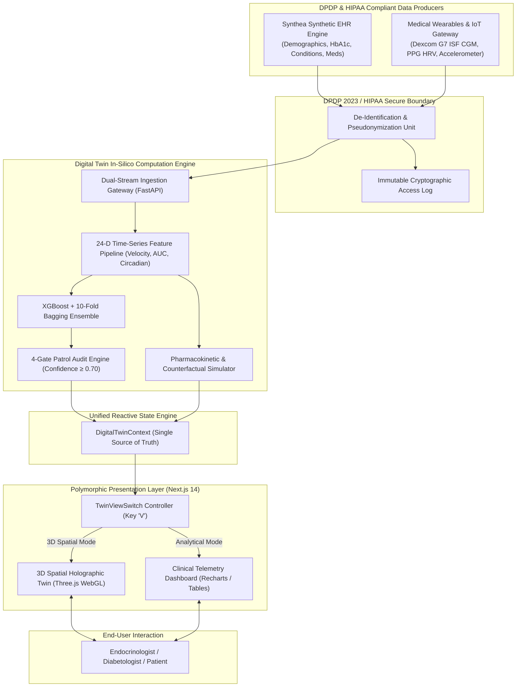

---

## 2. Component & Layered Architecture

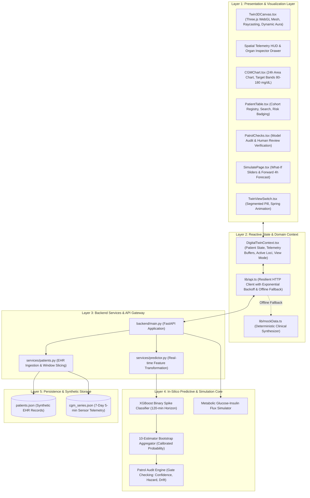

---

## 3. Deployment & Infrastructure Topology

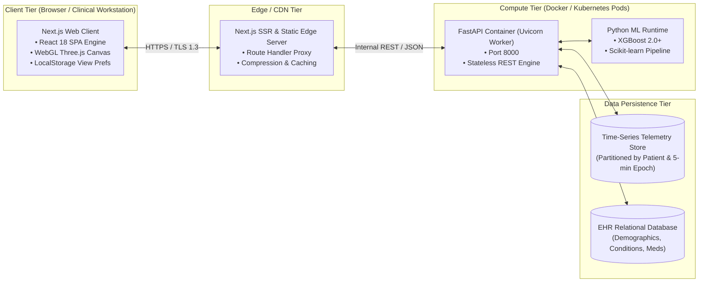

---

## 4. UML Class Diagram: Domain Model & Contracts

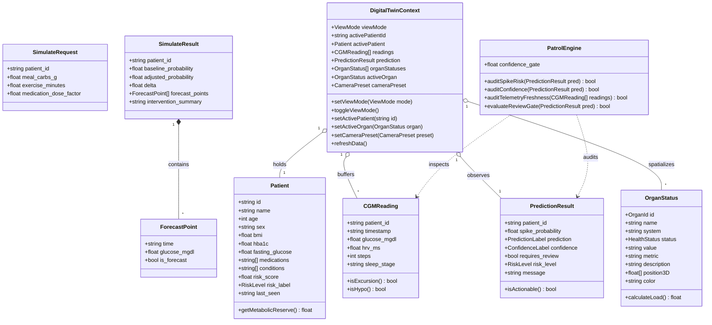

---

## 5. UML Sequence Diagram 1: Dual-Stream Ingestion & 2h Spike Prediction

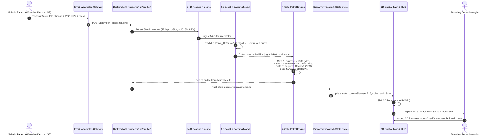

---

## 6. UML Sequence Diagram 2: In-Silico Intervention Simulation Workflow

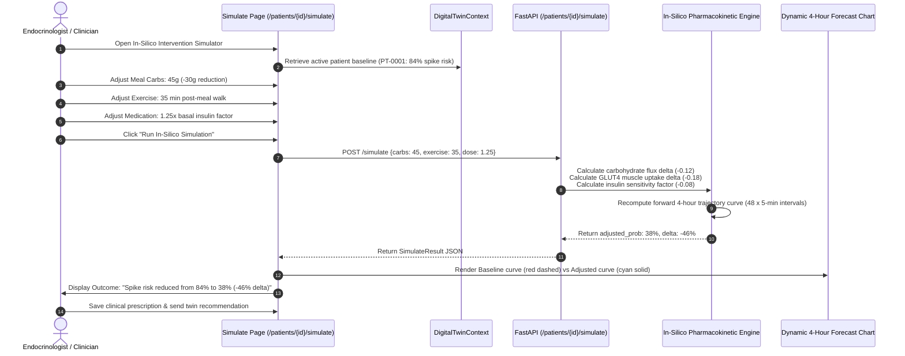

---

## 7. UML Sequence Diagram 3: Polymorphic Presentation Layer Transformation

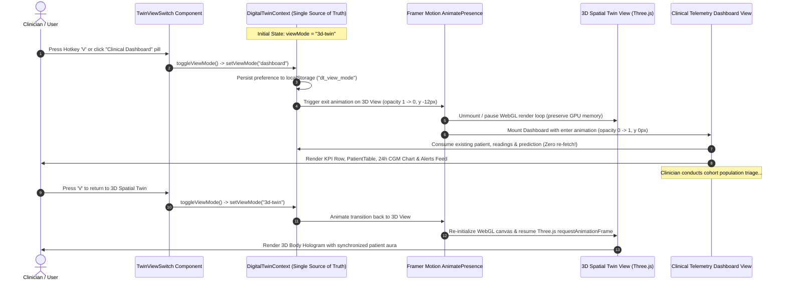

---

## 8. UML State Machine Diagram 1: Patient Glycemic Lifecycle

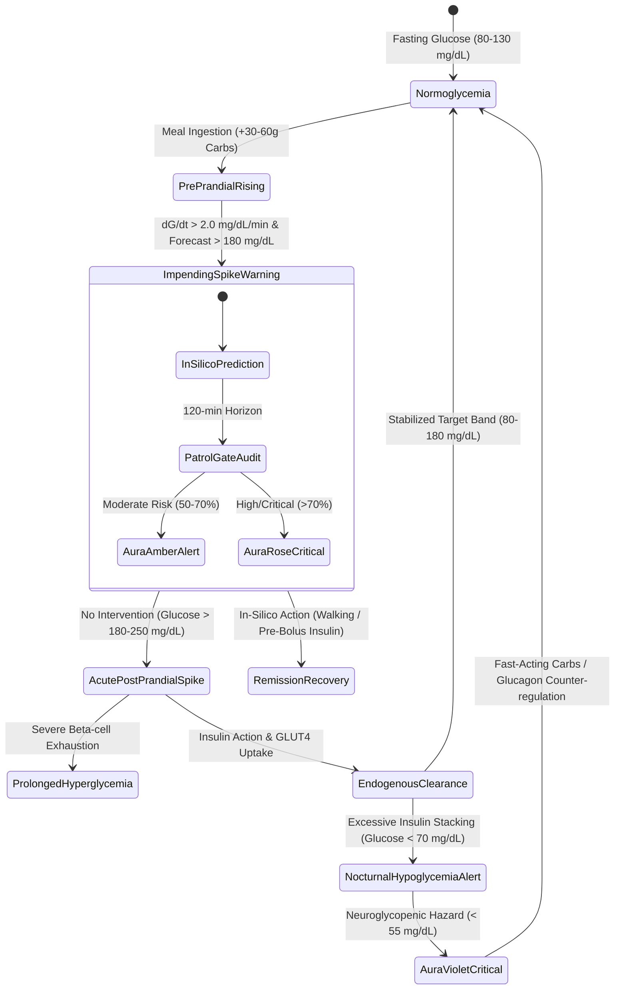

---

## 9. UML State Machine Diagram 2: Multi-Gate Safety Patrol Engine

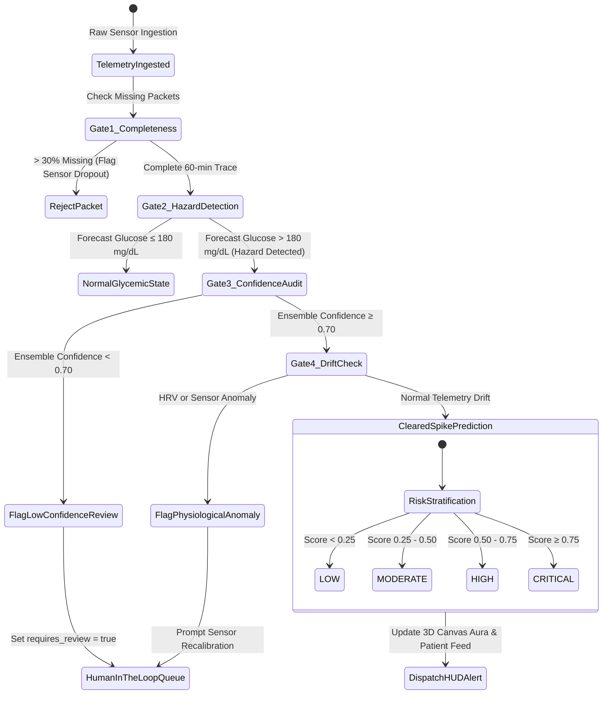

---

## 10. UML Activity Diagram: Clinical Triage & Intervention Decision Flow

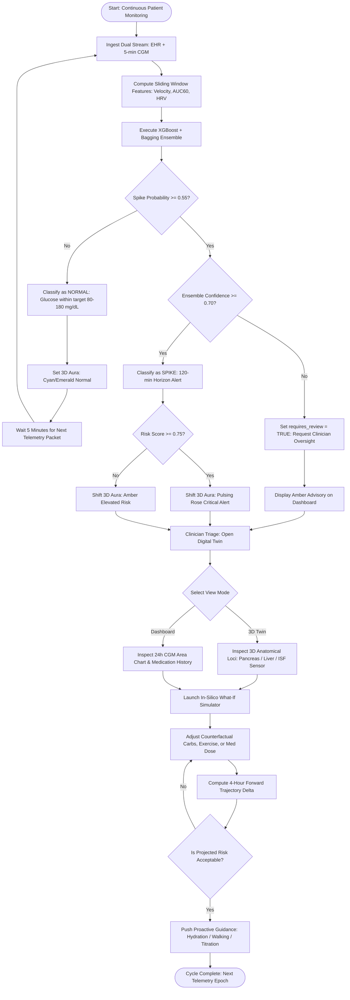

---

## 11. Database Entity-Relationship (ER) Diagram

The persistence layer is architected for hybrid clinical data modeling: relational schemas for static medical records alongside hyper-table partitioned time-series schemas for high-frequency wearable streams.

```mermaid
erDiagram
    PATIENTS ||--o{ CGM_READINGS : "generates"
    PATIENTS ||--o{ BIOMETRIC_STREAMS : "records"
    PATIENTS ||--o{ CONDITIONS : "diagnosed_with"
    PATIENTS ||--o{ MEDICATION_REGIMENS : "prescribed"
    PATIENTS ||--o{ PREDICTION_AUDITS : "evaluated_for"
    PATIENTS ||--o{ SIMULATION_RUNS : "simulated_in"
    WEARABLE_DEVICES ||--o{ CGM_READINGS : "transmits"

    PATIENTS {
        string patient_id PK "e.g., PT-0001"
        string full_name "Patient Name"
        int age "Age in years"
        string sex "M / F / Other"
        float bmi "Body Mass Index"
        float baseline_hba1c "Glycated Hemoglobin (%)"
        float baseline_fasting_glucose "Fasting blood sugar (mg/dL)"
        float risk_score "Continuous risk (0.0 to 1.0)"
        string risk_label "LOW | MODERATE | HIGH | CRITICAL"
        timestamp last_seen "Last clinical encounter"
        timestamp created_at "Record creation"
    }

    CONDITIONS {
        uuid condition_id PK
        string patient_id FK "References PATIENTS"
        string icd10_code "e.g., E11.9 (Type 2 Diabetes)"
        string condition_name "Clinical diagnosis"
        date diagnosis_date "Date of onset"
        string severity "MILD | MODERATE | SEVERE"
    }

    MEDICATION_REGIMENS {
        uuid regimen_id PK
        string patient_id FK "References PATIENTS"
        string drug_name "e.g., Metformin, Insulin Glargine"
        string dosage "e.g., 1000mg, 20U"
        string route "ORAL | SUBCUTANEOUS"
        string frequency "QD | BID | TID | PRN"
        boolean is_active "Active prescription status"
    }

    WEARABLE_DEVICES {
        string device_id PK "Hardware UUID / Serial"
        string patient_id FK "References PATIENTS"
        string device_type "CGM_SENSOR | SMARTWATCH | ACCELEROMETER"
        string manufacturer "Dexcom | Abbott | Apple | Garmin"
        float isf_diffusion_lag_min "Interstitial delay (typ. 5.2 min)"
        timestamp calibration_time "Last sensor calibration"
        float battery_pct "Battery status"
    }

    CGM_READINGS {
        uuid reading_id PK
        string patient_id FK "References PATIENTS"
        string device_id FK "References WEARABLE_DEVICES"
        timestamp recorded_at "5-min time-series timestamp"
        float glucose_mgdl "Subcutaneous ISF glucose value"
        float rate_of_change "Velocity dG/dt (mg/dL/min)"
        float sensor_trend_arrow "Trend direction: DOUBLE_UP to DOUBLE_DOWN"
        boolean is_calibrated "Calibration validity"
    }

    BIOMETRIC_STREAMS {
        uuid stream_id PK
        string patient_id FK "References PATIENTS"
        timestamp recorded_at "Timestamp epoch"
        float hrv_rmssd_ms "Heart rate variability (ms)"
        int step_count "5-min interval steps"
        string sleep_stage "WAKE | N1 | N2 | N3 | REM"
        float skin_temp_celsius "Peripheral skin temperature"
    }

    PREDICTION_AUDITS {
        uuid audit_id PK
        string patient_id FK "References PATIENTS"
        timestamp predicted_at "Model inference timestamp"
        float spike_probability "Ensemble probability P(Spike)"
        string prediction_label "SPIKE | NORMAL"
        string confidence_level "HIGH | MEDIUM | LOW"
        boolean requires_review "Safety patrol review gate"
        string risk_level "Assigned risk tier"
        json feature_vector_json "Captured 24-D feature inputs"
        json shap_attributions_json "SHAP local explainability weights"
    }

    SIMULATION_RUNS {
        uuid simulation_id PK
        string patient_id FK "References PATIENTS"
        timestamp executed_at "Simulation timestamp"
        float input_meal_carbs_g "Simulated carbohydrate intake"
        float input_exercise_min "Simulated physical activity"
        float input_med_factor "Medication dosage multiplier"
        float baseline_prob "Pre-simulation spike probability"
        float adjusted_prob "Post-simulation spike probability"
        float delta_prob "Net change in spike probability"
        json forecast_curve_json "48-point 4h forward trajectory"
    }
```

---

## 12. Biophysical Multi-Compartment Metabolic Flux Architecture

The digital twin's predictive simulator is grounded in mathematical physiology, modeling mass balance equations across six interconnected biological compartments:

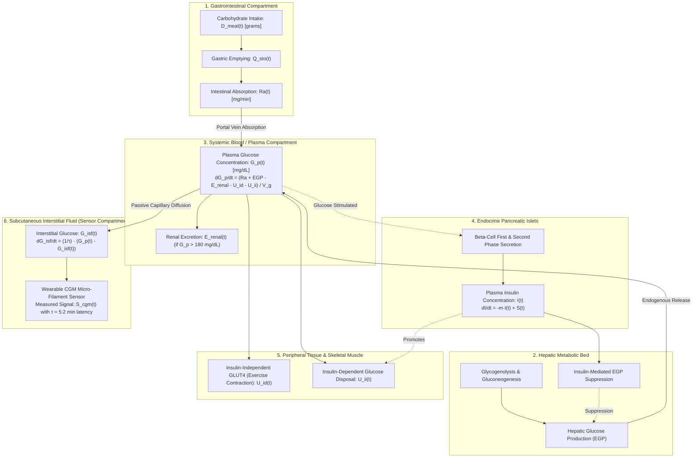

### Mathematical Formulation
1. **Interstitial Fluid Sensor Lag Differential Equation**:
   $$\frac{dG_{\text{isf}}(t)}{dt} = \frac{1}{\tau_{\text{diff}}} \left( G_{\text{plasma}}(t) - G_{\text{isf}}(t) \right)$$
   Where $\tau_{\text{diff}} \approx 5.2\text{ minutes}$ is the physiological diffusion time constant between arterial capillaries and subcutaneous interstitial fluid.

2. **Systemic Plasma Glucose Mass Balance**:
   $$\frac{dG_{\text{plasma}}(t)}{dt} = \frac{R_a(t) + \text{EGP}(t) - U_{\text{muscle}}(t) - E_{\text{renal}}(t)}{V_d}$$
   Where:
   - $R_a(t)$: Gut carbohydrate absorption rate.
   - $\text{EGP}(t)$: Endogenous hepatic glucose production.
   - $U_{\text{muscle}}(t)$: Combined insulin-dependent and contractile (exercise) GLUT4 uptake.
   - $E_{\text{renal}}(t)$: Glycosuria threshold excretion above $180\text{ mg/dL}$.
   - $V_d$: Glucose distribution volume ($\sim 260\text{ mL/kg}$).

3. **Predictive Ensemble Spike Formulation**:
   $$P(\text{Spike}_{120\text{m}}) = \frac{1}{M} \sum_{m=1}^{M} \sigma \left( f_m(\mathbf{x}_t) \right)$$
   Where $M = 10$ bagged XGBoost estimators, $\sigma$ is the sigmoid link function, and $\mathbf{x}_t \in \mathbb{R}^{24}$ is the multidimensional feature vector combining historical CGM lags, glycemic velocity, autonomic HRV, activity cadence, and static EHR biomarkers.

---

*Authored by Team Neuron for the Happiest Health Digital Twin Challenge 2026.*
